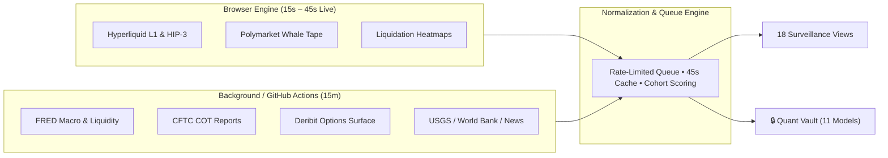

<div align="center">

# 0xHarpoon

### Quantitative Intelligence & Cross-Market Surveillance Terminal
**Real-time whale tracking, institutional order flow synthesis, and browser-native econometrics.**

<p>
  <a href="https://github.com/eclin-hub/0xHarpoon">
    
  </a>
  <a href="https://nodejs.org/">
    
  </a>
  <a href="https://github.com/eclin-hub/0xHarpoon">
    
  </a>
  <a href="https://github.com/eclin-hub/0xHarpoon">
    
  </a>
</p>

[Architecture](#01--system-architecture) • [Live Data Matrix](#02--real-time-data-matrix) • [Quant Vault Lab](#03--quant-vault-econometrics-lab) • [Terminal Modules](#04--terminal-modules-18-views) • [Quickstart](#05--quickstart--deployment)

</div>

---

## Executive Summary

Institutional trading desks and macro researchers face a structural bottleneck: **severe data fragmentation**. Reconciling on-chain perpetual positioning, prediction market probability shifts, derivatives skew, central bank net liquidity, and geopolitical risk typically requires switching across dozens of disconnected terminals.

**0xHarpoon** (Est. 2026) unifies multi-asset surveillance and quantitative factor modeling into a single, self-contained software artifact:

* **Zero External Dependencies (`0 npm packages`)** — Engineered purely on native Node.js 20+ primitives, HTML5 Canvas, D3.js, and Server-Sent Events (SSE). Immune to supply-chain bloat or dependency rot.
* **Dual-Speed Ingestion Engine** — Combines sub-minute browser polling for live order books and whale executions with automated background pipelines for macro, CFTC filings, and options surfaces.
* **Embedded Quantitative Lab (`Quant Vault`)** — Mounts a browser-native econometrics suite implementing Random Matrix Theory (Marchenko–Pastur), Kalman state-space filtering, and stochastic jump-diffusion modeling without server round-trips.

---

## 01 // System Architecture

**0xHarpoon** operates on a decoupled dual-tier pipeline that separates high-frequency client telemetry from periodic macro ingestion:



---

## 02 // Real-Time Data Matrix

Every data stream integrated into **0xHarpoon** queries public institutional or decentralized endpoints with **zero mandatory API keys** required out of the box:

| Domain | Source / Endpoint | Refresh Cadence | Extracted Signal & Analytical Purpose |
| :--- | :--- | :---: | :--- |
| **Perpetual DEX** | `Hyperliquid Mainnet & HIP-3` | `15s – 45s` | Top-100 smart-money cohort positions, funding rates, open interest, liquidation clusters (Crypto, Gold, Oil, Indices). |
| **Prediction Markets** | `Polymarket Gamma & Data API` | `30s – 90s` | Whale Tape (`>$10k` single fills), multi-whale convergence alerts, implied macro/political probabilities. |
| **Derivatives & Vol** | `Deribit Public API` | `15m` | Implied Volatility (IV) term structure, Put/Call ratios, $25\Delta$ Put–Call skew, options Max Pain levels. |
| **Institutional Flow** | `CFTC Commitments of Traders` | `15m` | Leveraged fund positioning across US equity, rates, FX, and commodity futures normalized to 3-year percentiles. |
| **Macro Liquidity** | `Federal Reserve (FRED)` | `15m` | Treasury yield curve ($10\text{Y}-2\text{Y}$), Fed Net Liquidity (`WALCL - TGA - RRP`), inflation breakevens, credit spreads. |
| **Geopolitics & OSINT** | `USGS / World Bank / News` | `15m / Live` | 25 monitored geopolitical flashpoints, live seismic telemetry, macro calendar (`ForexFactory`), Telegram & social feeds. |
| **Sentiment Proxies** | `DefiLlama / Wiki / AppStore` | `15m` | Stablecoin net inflows, retail attention spikes (Wikipedia pageviews, finance app rankings), Fear & Greed index. |

### Smart-Money Cohort Filtering (`lib/hl.mjs`)

To isolate genuine alpha from high-frequency market-making noise, Hyperliquid accounts are algorithmically filtered (`Equity >= $500k`, active within 7 days, positive monthly and all-time PnL, monthly turnover `< 300x` equity) and ranked via a composite factor score:

$$\text{Score}_i = 0.30 \cdot \text{PnL}_{1\text{M}} + 0.20 \cdot \text{PnL}_{\text{All}} + 0.25 \cdot \text{ROI}_{1\text{M}} + 0.25 \cdot \text{Equity}_i$$

---

## 03 // 🔒 Quant Vault: Econometrics Lab

Clicking **`🔒 QUANT VAULT`** inside the navigation bar transitions seamlessly into an isolated 11-module quantitative research laboratory in browser memory while preserving live telemetry streams in the background.

<table>
  <tr>
    <th width="28%">Module Suite</th>
    <th width="72%">Implemented Mathematical & Econometric Frameworks</th>
  </tr>
  <tr>
    <td><strong>Portfolio Geometry & Tail Risk</strong><br><em>(Tools 1 – 7)</em></td>
    <td>
      • Capital → Factor → CVaR Sankey attribution<br>
      • 3D Mean-Variance-CVaR efficient frontier & robustness landscape<br>
      • Minimum Spanning Tree (MST) contagion topology & correlation regime switching<br>
      • Bates stochastic volatility jump-diffusion cones & conditional beta surfaces
    </td>
  </tr>
  <tr>
    <td><strong>Latent Factor Extraction</strong><br><em>(Tool 11)</em></td>
    <td>
      • Orthogonalization against known market factors via OLS regression<br>
      • Residual covariance denoising via <strong>Marchenko–Pastur</strong> (Random Matrix Theory) or <strong>Ledoit–Wolf</strong> shrinkage<br>
      • PCA eigenportfolio decomposition, partial correlations, and hidden portfolio risk share (supports live Hyperliquid returns)
    </td>
  </tr>
  <tr>
    <td><strong>Asset Pricing & Volatility</strong><br><em>(Tools 8 – 10)</em></td>
    <td>
      • Dynamic factor extraction via <strong>Kalman Filter</strong> state-space estimation<br>
      • Time-varying betas, <strong>Fama–MacBeth</strong> two-pass regressions with <strong>Newey–West</strong> HAC standard errors<br>
      • <strong>Gibbons–Ross–Shanken (GRS)</strong> alpha test, <strong>Factor-GJR-GARCH</strong> asymmetric volatility, and <strong>Kupiec</strong> VaR backtesting (CSV/JSON export)
    </td>
  </tr>
</table>

---

## 04 // Terminal Modules (18 Views)

| Category | Modules | Core Capabilities |
| :--- | :--- | :--- |
| **Synthesis** | `Dashboard` • `Asset Directions` • `Edge Signals` | Global sentiment gauge, multi-factor directional scoring (BTC, ETH, SOL, SPX, NDX, Gold, Oil, DXY), cross-venue divergence alerts. |
| **World & Geopolitics** | `3D Globe` • `Intelligence Wire` • `Prediction Odds` | Interactive 3D globe with 25 tension hotspots, live USGS earthquakes, country intelligence drawers, Polymarket probability movers. |
| **Institutional & Macro** | `Macro Regime` • `Hedge Funds (COT)` • `Options Surface` | Yield curve dynamics, net liquidity impulse, CFTC 3-year historical percentiles, Deribit IV skew & expiry max-pain magnets. |
| **Whale Surveillance** | `Whale Tape` • `Account Inspector` • `Risk Tools` | Real-time `>$10k` Polymarket fills + Hyperliquid executions, portfolio PnL & 7-day history inspector, live liquidation heatmaps. |

---

## 05 // Quickstart & Deployment

### Local Execution (Full Live Mode)

Requires **Node.js 20+**. No `npm install` or build step required.

```bash
git clone https://github.com/eclin-hub/0xHarpoon.git
cd 0xHarpoon
node server.mjs
```

Open **`http://localhost:8787`** in your browser. Historical snapshots and activity logs persist locally inside `data/`.

| Environment Variable | Default | Description |
| :--- | :---: | :--- |
| `PORT` | `8787` | Local HTTP/SSE server listening port. |
| `HL_COHORT` | `100` | Number of top-ranked Hyperliquid smart-money accounts tracked. |
| `REFRESH_SCALE` | `1.0` | Polling interval multiplier (`0.5` = 2x faster live updates). |
| `X_BEARER_TOKEN` | *Optional* | Official X API v2 token (or `TWITTERAPI_IO_KEY` / `X_RSS_BASE`) for social wire ingestion. |

### Serverless Deployment (GitHub Pages + Actions)

**0xHarpoon** includes a pre-configured `.github/workflows/update.yml` workflow to publish and refresh automatically for free:

1. Push the repository to GitHub (public repository) and set **Settings → Pages → Source** to `GitHub Actions`.
2. Enable **Read and write permissions** under **Settings → Actions → General → Workflow permissions**.
3. Trigger **`Mise à jour des données`** in the **Actions** tab. GitHub executes `scripts/snapshot.mjs` every 15 minutes and persists historical state to the `state` branch.

---

<div align="center">
  <sub><strong>0xHarpoon</strong> — Built for quantitative transparency, cross-market synthesis, and zero-dependency resilience.</sub>
</div>
